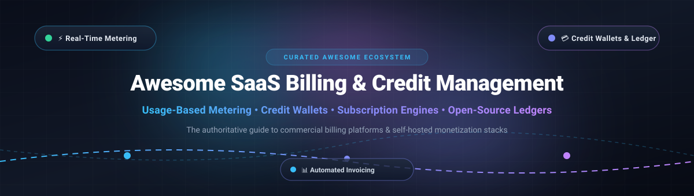

  

# 💳 Awesome SaaS Billing & Credit Management 🚀

> A curated list of production-grade **SaaS Billing**, **Usage-Based Metering**, **Credit Wallets**, and **Open-Source Billing Engines** for modern software, cloud services, and AI APIs.

---

## 📑 Table of Contents
- [🌐 Sector Overview & Market Dynamics](#-sector-overview--market-dynamics)
- [🏢 SaaS & Hosted Billing Platforms](#-saas--hosted-billing-platforms)
- [💻 Open-Source Billing & Credit Engines](#-open-source-billing--credit-engines)
  - [Usage Metering & Hybrid Billing](#-usage-metering--hybrid-billing)
  - [Enterprise Subscription & Invoicing](#-enterprise-subscription--invoicing)
  - [Credit Ledger & Developer SDKs](#-credit-ledger--developer-sdks)
  - [Self-Hosted Invoicing & Accounting](#-self-hosted-invoicing--accounting)
- [🤝 How to Contribute](#-how-to-contribute)
- [💖 Support & Sponsorship](#-support--sponsorship)
- [⭐ Star History](#-star-history)
- [⚠️ Disclaimer](#️-disclaimer)

---

## 🌐 Sector Overview & Market Dynamics

The global subscription billing software market is valued at approximately **$8.0B to $9.5B in 2026** and is projected to surpass **$19.5B by 2030**, exhibiting a robust CAGR of ~12–15%. The sector exhibits **medium concentration with a bifurcated structure**: enterprise subscription workflows are dominated by established giants (Stripe, Zuora, Chargebee, Maxio), while the burgeoning usage-based, API, and AI token billing segment remains dynamic and moderately fragmented with high-velocity innovation across specialized consumption meters and self-hosted open-source ledgers.

---

## 🏢 SaaS & Hosted Billing Platforms

The table below catalogs leading commercial platforms for SaaS billing, subscription lifecycle orchestration, and consumption metering. Entries are **sorted descending by company scale** (Market Capitalization or Private Valuation).

| Platform 🚀 | Starting Pricing 💰 | Free Tier / Free Trial Limits 🎁 | Scale (Valuation / Revenue) 📈 | Key Focus & Strengths 🎯 |
| :--- | :--- | :--- | :--- | :--- |
| **[Stripe Billing](https://stripe.com/billing)** | 0.7% per recurring transaction (plus payment processing) or $620/mo flat package | Pay-as-you-go available with no recurring monthly fee; free access to test-mode sandbox with unlimited test transactions and test clocks | **$159B Valuation** (~$6.8B ARR) | Industry-standard recurring billing, automated dunning, customer portal, smart retries, and unified multi-currency checkout. |
| **[Atlassian Wallet](https://crosslinktax.atlassian.net/wiki/spaces/CSC/pages/1869295407)** | Custom enterprise pricing / add-on for Atlassian ecosystem accounts | 30-day free trial on Cloud standard tiers (up to 10 users with full platform features) | **~$52B Market Cap** (~$6.57B FY26 Rev) | Managed store credits, customer prepaid balances, and automated reloads with ACH/card vaulting across product suites. |
| **[Chargebee](https://www.chargebee.com/)** | 0.75% of billing volume + base fees (Starter plan starts at $0 base + 0.75% after threshold) | **Free up to $250,000** in cumulative lifetime billing volume; 14-day free trial on enterprise modules | **$3.5B Valuation** (~$200M+ ARR) | Multi-gateway subscription lifecycle management, automated revenue recognition (ASC 606), and tax compliance. |
| **[Zuora](https://www.zuora.com/)** | Custom enterprise pricing (typically starts at ~$1,500 - $3,000/month or bespoke enterprise contracts) | 30-day sandbox trial upon sales qualification with full API and test billing workflows | **$1.7B Buyout / Private** (~$450M ARR) | High-volume enterprise subscription orchestration, CPQ, order-to-cash workflows, and complex multi-entity consolidation. |
| **[Metronome](https://metronome.com/)** | Starter plan has $0 platform fee + usage; Growth/Enterprise on custom contracts | **Free Starter Plan** (up to $50,000 monthly tracked usage with standard event ingestion) | **$1.0B Acquisition by Stripe** (~$470M Series C) | Ultra-high throughput event metering (100k+ events/sec), real-time pricing plans, and drawdown credit commits for AI/dev tools. |
| **[Maxio](https://www.maxio.com/)** | Essentials tier starting at $599/month (includes core subscription billing & reporting) | 14-day full-access sandbox trial with sample data and live test payment integrations | **$800M+ PE Backed** (~$100M+ ARR) | Merged power of Chargify and SaaSOptics for B2B SaaS metric intelligence, deferred revenue, and billing operations. |
| **[Orb](https://www.withorb.com/)** | Core platform plans starting at ~$720/month base + volume; custom enterprise tiers | 30-day production-ready sandbox trial with complete SQL-metric modeling and API access | **$335M Acquisition by Adyen** (~$44M Total Funding) | Developer-first usage billing engine, SQL-defined metrics, complex multi-attribute pricing matrices, and prepaid burns. |
| **[Recurly](https://recurly.com/)** | Core Starter plan starting at $249/month + 0.9% of transaction volume | 14-day free trial on Starter plan with full recurring billing and gateway simulation | **$300M+ Est. Valuation** (~$55M+ ARR) | Machine-learning dunning engines, decline recovery, multi-gateway support, and subscription churn reduction. |
| **[Lago (Cloud)](https://www.getlago.com/)** | Cloud Starter starts at $0 base + $0.0001/event after threshold; Pro starts at $490/month | **Free Cloud Tier** includes 100,000 events/month, 30 active subscriptions, and customer portal | **~$150M Est. Valuation** ($22M+ Series A) | Fully-managed cloud deployment of Lago featuring real-time meter ingestion, hybrid subscriptions, and prepaid credits. |
| **[Ordway](https://ordwaylabs.com/)** | Growth tier starting at $499/month (custom quote for multi-currency & RevRec) | 14-day sandbox access upon guided demonstration with simulated multi-entity billing | **$80M+ Est. Valuation** ($30M+ Total Funding) | Smart quote-to-cash, billing automation, automated deferred revenue recognition, and bidirectional general-ledger sync. |

---

## 💻 Open-Source Billing & Credit Engines

Self-hostable, developer-friendly frameworks and services for meter ingestion, prepaid credit balances, subscription billing, and automated invoicing. Repositories are **sorted descending by GitHub star count**.

### 🌟 Top Open-Source Projects by Stars

| Repository 📦 | GitHub Stars 🌟 | License 📄 | Architecture & Stack 🛠️ | Core Strengths 💡 |
| :--- | :--- | :--- | :--- | :--- |
| **[Lago](https://github.com/getlago/lago)** |  | AGPL-3.0 | Ruby on Rails, Go, PostgreSQL, Redis | Open-source Stripe Billing alternative for event-based metering, hybrid subscription pricing, and automated invoice delivery. |
| **[Invoice Ninja](https://github.com/invoiceninja/invoiceninja)** |  | Elastic-2.0 | PHP (Laravel), Flutter, MySQL/PostgreSQL | Comprehensive self-hosted invoicing, recurring subscription billing, client management portal, and support for 50+ payment gateways. |
| **[Akaunting](https://github.com/akaunting/akaunting)** |  | BUSL-1.1 | PHP (Laravel), Vue.js, MySQL | Full-featured modular business accounting, invoice generation, expense tracking, and subscription billing app ecosystem. |
| **[Crater](https://github.com/crater-invoice/crater)** |  | AGPL-3.0 | PHP (Laravel), Vue.js, MySQL | Clean, modern self-hosted suite for invoice creation, automated recurring invoices, payment tracking, and client estimates. |
| **[Flexprice](https://github.com/flexprice/flexprice)** |  | Apache-2.0 | Go, PostgreSQL, ClickHouse | Real-time usage-based pricing and billing engine featuring credits, top-up wallets, no-code UI, and feature entitlement gating. |
| **[Kill Bill](https://github.com/killbill/killbill)** |  | Apache-2.0 | Java, OSGi, PostgreSQL/MySQL | Battle-tested subscription billing and payments platform in production since 2010; handles complex dunning, tax plugins, and multi-tenancy. |
| **[OpenMeter](https://github.com/openmeterio/openmeter)** |  | Apache-2.0 | Go, ClickHouse, PostgreSQL, Kafka | Real-time event metering for AI & cloud APIs with CloudEvents ingestion, prepaid credit burn-down, entitlement gating, and Stripe sync. |
| **[Tier](https://github.com/tierrun/tier)** |  | BSD-3-Clause | Go | Pricing engine SDK that manages Stripe-backed pricing models, tier structures, and usage gating directly from JSON definitions. |
| **[PayCan Credit](https://github.com/gatewayhubs/paycan-credit)** |  | MIT | PHP (Laravel / Filament), JavaScript | Lightweight self-hosted credit wallet and payment engine with drop-in front-end modal web components and multi-wallet isolation. |
| **[Bursar](https://github.com/zonastery/bursar)** |  | MIT / Apache-2.0 | Go, Python, TypeScript, PostgreSQL | Financial-grade credit ledger SDK with reserve-then-settle lease primitives, zero-eval AST expression evaluator, and strict balance controls. |

---

### ⚡ Usage Metering & Hybrid Billing

- **[Lago](https://github.com/getlago/lago)**  — The open-source alternative to Stripe Billing and Chargebee. Provides high-scale event ingestion, custom aggregation metrics, credit top-ups, add-on management, and native gateway connectors.
- **[Flexprice](https://github.com/flexprice/flexprice)**  — Built for developers monetizing AI models and APIs. Features dynamic credit ledgers, self-hosted UI, real-time meter pipelines, and flexible plan rate cards.
- **[OpenMeter](https://github.com/openmeterio/openmeter)**  — CloudEvents-based real-time metering engine built on Go, ClickHouse, and Kafka. Features sub-millisecond balance checks, token counters for LLMs, and priority credit expiration algorithms.

---

### 🏛️ Enterprise Subscription & Invoicing

- **[Kill Bill](https://github.com/killbill/killbill)**  — Production-proven enterprise recurring billing and payments router. Features multi-currency invoicing, customizable dunning schedules, subscription lifecycle hooks, and plugin integrations.
- **[Tier](https://github.com/tierrun/tier)**  — Lightweight CLI and Go/Node SDK that abstracts pricing model versions directly into Stripe, removing hardcoded tier logic from application codebases.

---

### 💳 Credit Ledger & Developer SDKs

- **[Bursar](https://github.com/zonastery/bursar)**  — Canonical accounting ledger SDK for AI SaaS applications. Implements reserve-then-settle leases with idempotency guarantees, expiry-aware lots, and unified Go/TypeScript/Python client libraries.
- **[PayCan Credit](https://github.com/gatewayhubs/paycan-credit)**  — Self-hosted credit engine with ready-made Shadow DOM UI modals for token top-ups, recurring credit refreshes, and multi-balance user accounts.
- **[stapel-billing](https://pypi.org/project/stapel-billing/)** — Django framework extension providing per-user credit wallet models, reserve/capture/release workflows, and Stripe checkout integration.
- **[credit-management (PyPI)](https://pypi.org/project/credit-management/)** — Python FastAPI middleware offering reserve-then-deduct interceptors for tracking prompt/completion tokens against user credit balances.

---

### 🧾 Self-Hosted Invoicing & Accounting

- **[Invoice Ninja](https://github.com/invoiceninja/invoiceninja)**  — Feature-rich open-source invoicing and recurring subscription platform with client self-service portals and support for 50+ payment gateways.
- **[Akaunting](https://github.com/akaunting/akaunting)**  — Modular accounting and invoicing software with an app store for subscription billing, multi-currency accounting, and bank reconciliation.
- **[Crater](https://github.com/crater-invoice/crater)**  — Open-source invoicing tool designed for freelancers and small businesses, featuring automated recurring invoices, detailed tax breakdowns, and mobile apps.

---

## 🤝 How to Contribute

We welcome additions, corrections, and improvements from billing engineers and founders!

1. 🍴 Fork the repository.
2. 🌿 Create a descriptive feature branch (`git checkout -b add-my-billing-engine`).
3. 📝 Add your tool or library adhering to the tabular format (include starting tier pricing, free tier limits, and verifiable data).
4. 🚀 Open a Pull Request detailing the changes and links to official documentation.

---

## 💖 Support & Sponsorship

Thank you so much for exploring and using this repository! Maintaining and curating production-ready resources takes dedicated effort and continuous research.

If you find this ecosystem guide helpful:
- ⭐ **Star** this repository on GitHub to show your appreciation and help others find it.
- 🍴 **Fork** it to build your own customization or contribute improvements back.
- 📢 **Share** it with fellow billing architects, SaaS founders, and engineers.
- ☕ **Buy me a coffee / Sponsor**: If you'd like to support ongoing updates and open-source tooling curation, you can sponsor through the **[GitHub Sponsors Dashboard](https://github.com/sponsors/ishandutta2007)**!

---

## ⭐ Star History

---

## ⚠️ Disclaimer

- This curated list is maintained for educational and architectural reference purposes.
- Billing systems handling cardholder data must comply with **PCI DSS** standards. Self-hosting payment systems requires strict operational controls, secure key management, and regular compliance auditing.
- Before adopting self-hosted or open-source solutions, review their licenses (e.g., AGPL-3.0, Apache-2.0, Elastic-2.0) to ensure compliance with your organization's legal policies.

---

  <b>⭐ Star this repository if you find it valuable for your monetization and billing infrastructure! ⭐</b>

